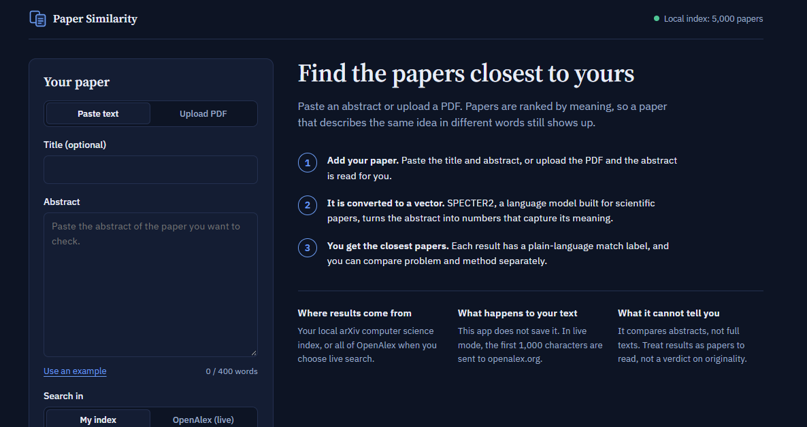
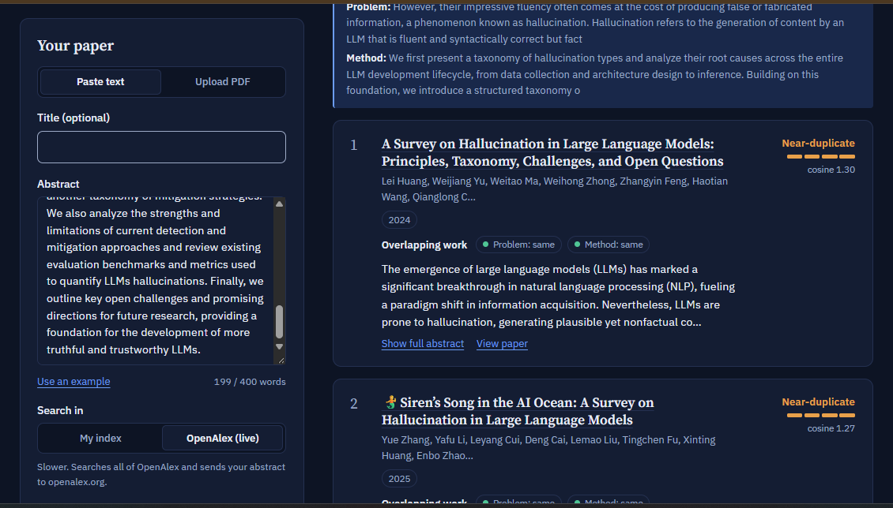

# Research Paper Similarity Checker

Discover research papers that are semantically related to your work — beyond simple keyword matching.

Finding relevant literature is an important part of research, but traditional keyword-based searches can miss papers that investigate similar ideas using different terminology. A paper may address the same research problem as yours without sharing many of its keywords. Another may use a similar methodology to solve an entirely different problem.

**Research Paper Similarity Checker** helps explore these connections. Provide a research title and abstract, or upload a PDF, to find related papers ranked by semantic similarity. You can also compare papers based on their research problems and methodologies separately.

The application supports two search modes:
- **Local search:** Find similar papers from a locally built collection using SPECTER2 embeddings and FAISS.
- **OpenAlex search:** Search OpenAlex's live semantic search service for a broader collection of research papers.

## Screenshots

<!-- Add screenshots to the screenshots/ directory using the filenames below. -->

### Search Interface



### Similarity Results



## Features

- **Semantic paper search:** Discover related research using SPECTER2 embeddings rather than relying only on shared keywords.
- **Two search sources:** Search a locally indexed paper collection or use OpenAlex's live semantic search.
- **PDF input:** Upload a research paper PDF and automatically extract its title and abstract. Review and correct the extracted text before searching.
- **Problem and method comparison:** Compare research problems and methodologies separately to identify different kinds of similarity.
- **Similarity labels:** Results are grouped into Near-duplicate, Closely related, Related, and Loosely related categories based on configurable score thresholds.
- **Transparent scores:** View raw cosine similarity scores alongside the estimated similarity labels.
- **Responsive interface:** Supports desktop and mobile layouts.
- **Light and dark themes:** Switch between themes for a more comfortable reading experience.

## How It Works

The application uses different retrieval mechanisms depending on the selected search source.

### 1. Input Processing

Users can provide a research title and abstract directly or upload a PDF.

For PDF uploads, PyMuPDF extracts the title and abstract. The extracted content is displayed so users can review and correct it before submitting a search.

Abstracts are limited to 400 words.

### 2. Local Semantic Search

Local search uses **SPECTER2**, a scientific document embedding model developed by the Allen Institute for AI.

1. The input abstract is converted into a 768-dimensional embedding using the SPECTER2 `proximity` adapter.
2. FAISS searches the local vector index for the nearest paper embeddings.
3. The corresponding paper metadata is retrieved from the local dataset.
4. Results are ranked by cosine similarity.

The local index is built from arXiv metadata and can optionally include additional OpenAlex data.

### 3. OpenAlex Live Search

The live search option uses OpenAlex's semantic search functionality.

The first 1,000 characters of the submitted abstract are sent to OpenAlex, which returns semantically related research papers.

Unlike local search, this mode does not query the application's FAISS index.

### 4. Problem and Method Comparison

The application can optionally compare research problems and methodologies separately.

This process uses heuristic sentence extraction based on cue phrases commonly found in academic abstracts.

For example:
- Problem-related phrases: "remains a challenge", "has received considerable attention".
- Method-related phrases: "we propose", "we introduce", "we employ".

The extracted problem and method sentences are embedded separately and compared with the corresponding sections of each result.

This produces separate problem and method similarity scores, helping distinguish papers that investigate similar problems from those that use similar approaches.

**Note:** Problem and method extraction is heuristic-based. It is not a trained research-contribution classifier, and its output should be interpreted accordingly.

### 5. Similarity Classification

Raw cosine similarity scores are mapped to readable categories using configurable thresholds.

The labels are:

| Label | Meaning |
|---|---|
| Near-duplicate | Very high semantic similarity |
| Closely related | Strong semantic similarity |
| Related | Moderate semantic similarity |
| Loosely related | Lower semantic similarity |

The thresholds are configurable because similarity scores can vary across datasets and search sources.

These labels are estimates, not validated judgments of research equivalence or originality.

## Technology Stack

| Component | Technology |
|---|---|
| Frontend | React, Vite |
| Styling | CSS |
| Backend | Python, FastAPI |
| Scientific embeddings | SPECTER2 |
| Vector search | FAISS |
| PDF extraction | PyMuPDF |
| External paper search | OpenAlex API |
| Data sources | arXiv, OpenAlex |

## Project Structure

```text
.
├── backend/
│   ├── app/
│   │   ├── main.py          # FastAPI endpoints, live search and scoring
│   │   ├── embedder.py      # SPECTER2 embedding generation
│   │   ├── search.py        # FAISS search and metadata retrieval
│   │   ├── pdf.py           # PDF title and abstract extraction
│   │   └── roles.py         # Problem and method sentence extraction
│   │
│   ├── scripts/
│   │   ├── build_index.py   # Builds the local FAISS index
│   │   └── fetch_openalex.py# Downloads OpenAlex metadata
│   │
│   └── data/                # Local datasets and generated index
│
└── frontend/
    ├── src/
    │   ├── App.jsx
    │   ├── styles.css
    │   └── main.jsx
    └── index.html
```

## Getting Started

### Prerequisites

- Python 3.10 or newer
- Node.js 18 or newer
- Git
- A GPU is optional but recommended when building a large local index.
- A free OpenAlex API key is required for live search and downloading OpenAlex data.

### 1. Clone the Repository

```bash
git clone <YOUR_REPOSITORY_URL>
cd <YOUR_REPOSITORY_DIRECTORY>
```

### 2. Set Up the Backend

```bash
cd backend

python -m venv .venv
```

Activate the virtual environment.

**Windows (Command Prompt):**

```bash
.venv\Scripts\activate
```

**Windows (PowerShell):**

```powershell
.venv\Scripts\Activate.ps1
```

**macOS / Linux:**

```bash
source .venv/bin/activate
```

Install the dependencies:

```bash
pip install -r requirements.txt
```

### 3. Prepare the Paper Dataset

The local search feature requires a prebuilt paper index.

#### Option A: arXiv Dataset

Download the arXiv metadata snapshot from:

[arXiv Metadata Dataset – Kaggle](https://www.kaggle.com/datasets/Cornell-University/arxiv)

Extract the downloaded archive and place:

```text
arxiv-metadata-oai-snapshot.json
```

inside:

```text
backend/data/
```

#### Option B: OpenAlex Dataset (Optional)

You can also add OpenAlex metadata to your local collection.

First, obtain an API key from [OpenAlex](https://openalex.org/settings/api).

Set the environment variable:

**Windows (Command Prompt):**

```cmd
set OPENALEX_API_KEY=your_api_key
```

**Windows (PowerShell):**

```powershell
$env:OPENALEX_API_KEY="your_api_key"
```

**macOS / Linux:**

```bash
export OPENALEX_API_KEY=your_api_key
```

Download computer science papers published between 2020 and 2025:

```bash
python -m scripts.fetch_openalex --max 50000 --filter "primary_topic.field.id:17,publication_year:2020-2025"
```

The field ID `17` represents Computer Science. Use `primary_topic.field.id`, not `primary_topic.field.display_name`, in the filter.

### 4. Build the Local Search Index

Run the index builder from the `backend/` directory.

For an initial test, build a small index:

```bash
python -m scripts.build_index \
  --input data/arxiv-metadata-oai-snapshot.json \
  --prefix cs. \
  --limit 5000
```

For a larger and more varied collection, use:

```bash
python -m scripts.build_index \
  --input data/arxiv-metadata-oai-snapshot.json \
  --prefix cs.CV,cs.CL,cs.LG,cs.AI \
  --min-year 2018 \
  --sample \
  --limit 100000 \
  --extra data/openalex.jsonl
```

#### Index Builder Options

| Option | Description |
|---|---|
| `--input` | Path to the arXiv metadata dataset |
| `--prefix` | arXiv categories to include, separated by commas |
| `--min-year` | Excludes papers published before the specified year |
| `--sample` | Selects a random subset instead of taking the first N papers |
| `--limit` | Maximum number of arXiv papers to process |
| `--extra` | Additional JSONL datasets to include, such as OpenAlex metadata |

The generated files are:

```text
backend/data/
├── index.faiss
└── papers.jsonl
```

If you build the index on another machine, copy these two files into `backend/data/`.

**Why use `--min-year` and `--sample`?**

The arXiv metadata snapshot is roughly ordered by submission date. Taking the first few thousand computer science papers may therefore produce a collection dominated by older papers.

Using a publication-year filter and random sampling helps create a more varied collection.

Rebuild the index whenever you change the dataset, filters, or embedding implementation. Restart the API after rebuilding because the running application keeps its loaded index in memory.

### 5. Start the Backend API

From the `backend/` directory:

```bash
uvicorn app.main:app --reload --port 8000
```

The API will be available at:

- Health check: `http://localhost:8000/api/health`
- Interactive API documentation: `http://localhost:8000/docs`

The health endpoint reports the number of papers available in the local index.

### 6. Start the Frontend

Open another terminal:

```bash
cd frontend

npm install
npm run dev
```

Open the application:

```text
http://localhost:5173
```

The frontend development server forwards `/api` requests to the backend running on port `8000`.

## Using the Application

1. Choose **Paste text** or **Upload PDF**.
2. Provide the research title and abstract, or review the extracted PDF content.
3. Select a search source:
   - **My index:** Searches the locally built FAISS index.
   - **OpenAlex (live):** Uses OpenAlex's semantic search service.
4. Optionally enable **Compare problem and method**.
5. Click **Find similar papers**.
6. Explore the ranked results, similarity scores, and problem/method comparisons.

## API Reference

The backend exposes the following endpoints.

### `GET /api/health`

Checks the API and local index status.

Example response:

```json
{
  "status": "ok",
  "papers": 104212
}
```

The paper count is illustrative and depends on the index built by the user.

### `POST /api/search`

Searches for papers using a provided title and abstract.

Example request:

```json
{
  "title": "An optional research title",
  "abstract": "Your research abstract goes here. It must contain at least 20 characters.",
  "k": 10,
  "source": "local",
  "roles": false
}
```

| Field | Description |
|---|---|
| `title` | Optional research paper title |
| `abstract` | Research abstract; at least 20 characters and at most 400 words |
| `k` | Number of results to return (1–50) |
| `source` | Search source: `local` or `web` |
| `roles` | Enables separate problem and method comparison |

When `roles` is enabled, results include `problem_score` and `method_score`, along with `query_roles` containing the extracted sentences from the input abstract.

Example using cURL:

```bash
curl -X POST http://localhost:8000/api/search \
  -H "Content-Type: application/json" \
  -d '{"abstract": "We study how vision-language models revise correct answers after misleading feedback...", "k": 5}'
```

Each result contains:

- `id`
- `title`
- `authors`
- `year`
- `categories`
- `abstract`
- `score` — cosine similarity score
- `url`

### `POST /api/search-pdf`

Accepts a PDF upload and extracts its title and abstract before performing a search.

**Request format:** `multipart/form-data`

| Parameter | Description |
|---|---|
| `file` | PDF file (maximum 20 MB) |
| `k` | Number of results |
| `source` | `local` or `web` |
| `roles` | Enables problem and method comparison |

The response follows the same structure as `/api/search` and includes the extracted title and abstract under `query`.

### Error Responses

| Status | Description |
|---|---|
| `400` | PDF could not be read |
| `413` | Uploaded PDF exceeds 20 MB |
| `422` | Abstract is too short, exceeds 400 words, or no abstract could be extracted |
| `502` | OpenAlex returned an error or timed out |
| `503` | Live search requested without an OpenAlex API key |

## Configuration and Tuning

Similarity labels and problem/method classification thresholds can be adjusted in the source code.

| Configuration | Location | Default |
|---|---|---|
| Score-to-label calibration | `frontend/src/App.jsx` (`SCALE`) | Local: 0.70 / 0.97; Web: 0.88 / 0.97 |
| Problem/method thresholds | `frontend/src/App.jsx` (`ROLE`) | 0.90 / 0.80 |
| Abstract word limit | `backend/app/main.py`, `frontend/src/App.jsx` (`MAX_WORDS`) | 400 |
| OpenAlex query length | `backend/app/main.py` (`WEB_QUERY_CHARS`), `frontend/src/App.jsx` (`WEB_CHARS`) | 1000 |
| Problem/method cue phrases | `backend/app/roles.py` (`METHOD`, `PROBLEM`) | Defined in source |

The score-to-label thresholds are estimates and should be calibrated against papers whose relevance you already understand.

**Important:** Cosine similarity scores are not probabilities, percentages of similarity, or proof that two papers make equivalent research contributions.

## Troubleshooting

**`FileNotFoundError: data/arxiv-metadata-oai-snapshot.json`**

Check that the dataset has been extracted and placed in the correct directory:

```text
backend/data/arxiv-metadata-oai-snapshot.json
```

**Search results look unrelated**

- Check the number of indexed papers using `/api/health`.
- Rebuild the index with appropriate categories and publication-year filters.
- Confirm that `index.faiss` and `papers.jsonl` were generated from the same build.

**A paper in the index does not appear as the first result**

A paper should generally have a very high similarity score against its own embedding. If it does not, check whether the FAISS index and metadata files belong to the same build and whether the SPECTER2 adapter loaded successfully.

**OpenAlex returns HTTP 400**

Check the filter syntax. Use:

```text
primary_topic.field.id:17
```

rather than:

```text
primary_topic.field.display_name
```

**OpenAlex returns a 502 error or times out**

OpenAlex semantic search may time out on longer queries. The backend retries with shorter query lengths (1,000, 500, and 250 characters). If the request continues to fail, retry later or use local search.

**503: Web search needs an OpenAlex API key**

Set `OPENALEX_API_KEY` in the same terminal used to start the backend, then restart the API.

**Server not reachable**

Ensure the backend is running on port `8000` and the frontend is forwarding `/api` requests correctly.

## Limitations

- **Abstract-based matching:** The system compares abstracts rather than full paper content. Relevant details present only in the full text may be missed.
- **No plagiarism detection:** Semantic similarity does not establish plagiarism, research duplication, or lack of originality.
- **Heuristic problem/method extraction:** Cue-phrase-based extraction may fail when abstracts use unconventional wording or do not explicitly describe their problem and methodology.
- **Estimated similarity labels:** The labels depend on configurable thresholds and are not independently validated relevance judgments.
- **Local collection coverage:** Local search can only retrieve papers included in the generated index.
- **External service dependency:** Live search depends on OpenAlex availability and a valid API key.
- **Data privacy:** In live search mode, the submitted abstract is sent to OpenAlex. The application itself does not store searches, but a deployed server may log request bodies depending on its hosting and logging configuration.
- **Deployment configuration:** CORS is configured for `http://localhost:5173` by default. Update the configuration in `backend/app/main.py` before deploying the frontend elsewhere.

## Credits and Data Sources

- **Scientific paper embeddings:** [SPECTER2](https://huggingface.co/allenai/specter2_base) by the Allen Institute for AI.
- **Research paper metadata:** [arXiv](https://arxiv.org/) and the [arXiv metadata dataset on Kaggle](https://www.kaggle.com/datasets/Cornell-University/arxiv).
- **Live semantic search and metadata:** [OpenAlex](https://openalex.org/).
- **Vector similarity search:** [FAISS](https://github.com/facebookresearch/faiss).
- **PDF processing:** [PyMuPDF](https://pymupdf.readthedocs.io/).

Please review the terms and conditions of each data source before redistributing datasets or metadata.

---

*Built as a research-oriented semantic search project.*
